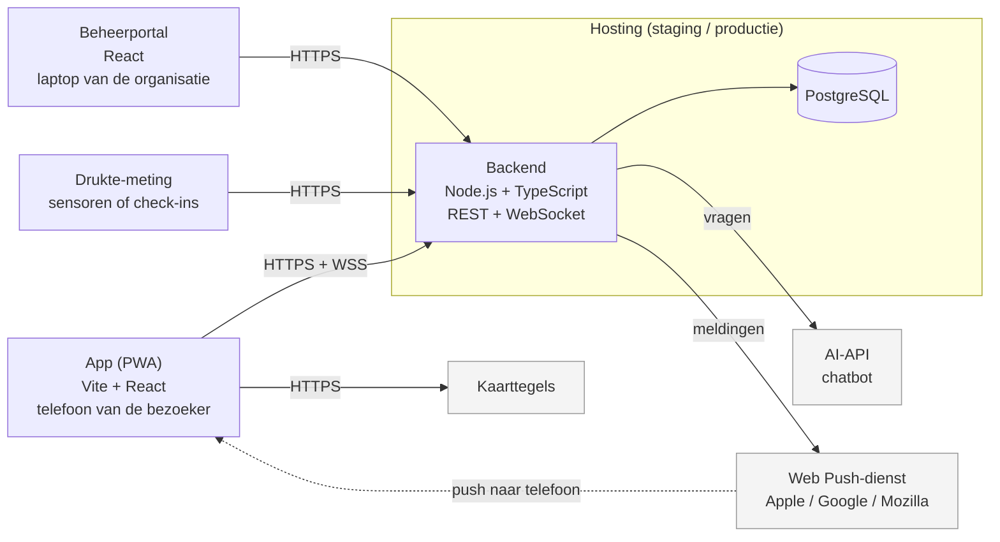

# Architectuur

Dit document beschrijft de opbouw van Festivalapp op hoofdlijnen: de onderdelen, hoe ze met elkaar praten, en waar de vertrouwensgrenzen liggen. Details per onderdeel staan in de ontwerpdocumenten van het team.

## Overzicht

## Onderdelen

| Onderdeel | Map | Techniek | Verantwoordelijk | Wat het doet |
| --- | --- | --- | --- | --- |
| **App** | `app/` | Vite, React, TypeScript, `vite-plugin-pwa` | Niek | De PWA voor bezoekers: kaart, vrienden, chat, timetable, SOS. Werkt deels offline via de service worker |
| **Beheerportal** | `portal/` | React, TypeScript | Moses | Website voor de organisatie: timetable beheren, noodberichten versturen, SOS-meldingen afhandelen |
| **Backend** | `backend/` | Node.js 24, TypeScript, WebSockets | Bob | De API uit [`api.yaml`](api.yaml), realtime-verbinding voor locaties en chat, pushmeldingen versturen |
| **Database** | – | PostgreSQL | Bob, Moses | Gebruikers, vriendschappen, berichten, timetable, meldingen |
| **Drukte-meting** | – | Nog te kiezen | Christian | Meet de drukte per podium en stuurt die naar de backend |
| **Mock-server** | `tools/` | Node.js | Gijs | Nep-backend op basis van `api.yaml`, alleen voor ontwikkeling |

## Communicatie

| Van → naar | Protocol | Inloggen | Wat |
| --- | --- | --- | --- |
| App → backend | HTTPS (REST) | Access token (JWT, 15 min) | Alle acties uit `api.yaml` |
| App ↔ backend | WSS (WebSocket) | Access token als eerste bericht | Locaties van vrienden, chat, noodberichten, timetable-wijzigingen |
| Portal → backend | HTTPS (REST) | Access token met rol `organisator`, `ehbo` of `security` | De `/admin/`-endpoints |
| Backend → Web Push-dienst | HTTPS | VAPID-sleutels | Meldingen naar telefoons |
| Backend → AI-API | HTTPS | API-key (in GitHub Secrets / `.env`) | Vragen aan de chatbot |
| Drukte-meting → backend | HTTPS | Eigen apparaat-token | Drukte per podium |

De afspraken over endpoints, invoer en foutcodes staan in [`api.yaml`](api.yaml) en worden automatisch gecontroleerd door de contracttests in `tests/`.

## Vertrouwensgrenzen

Op elke grens tussen de blokken in het diagram komt data binnen die we niet zomaar vertrouwen:

1. **Telefoon → backend.** Alles wat de app stuurt, kan door een gebruiker aangepast zijn. De backend controleert daarom altijd zelf: wie is ingelogd, mag deze persoon deze gegevens zien (bijvoorbeeld alleen locaties van geaccepteerde vrienden), en is de invoer geldig.
2. **Portal → backend.** Alleen gebruikers met een beheerrol mogen de `/admin/`-endpoints gebruiken. De rol wordt in de backend gecontroleerd, niet alleen in het portal.
3. **Backend → externe diensten.** We sturen alleen wat nodig is. De AI-API krijgt geen namen of locaties van gebruikers.
4. **Drukte-meting → backend.** Metingen komen van apparaten met een eigen token; onbekende bronnen worden geweigerd.

Hoe we per grens de risico's afdekken, staat in het threat model en in [`security-eisen.md`](security-eisen.md).

## Belangrijke keuzes

| Keuze | Waarom |
| --- | --- |
| **PWA in plaats van native apps** | Eén codebase voor iPhone, Android en desktop, geen App Store nodig. Nadeel: geen locatie op de achtergrond, en op iPhone werken pushmeldingen alleen als de app op het beginscherm staat |
| **REST + WebSocket** | REST voor gewone acties, WebSocket voor wat direct moet aankomen (locaties, chat, noodberichten) |
| **PostgreSQL** | Betrouwbare relationele database, geschikt voor de relaties tussen gebruikers, vrienden en berichten |
| **TypeScript overal** | Eén taal voor app, portal en backend; fouten worden eerder gevonden |
| **API-specificatie als contract** | `api.yaml` is de afspraak tussen app en backend; zo kunnen beide tegelijk gebouwd worden |